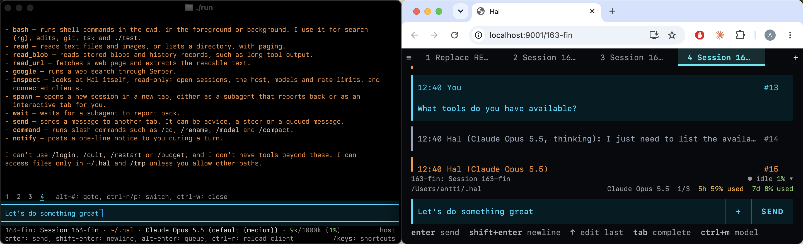

# Hal

This is HAL 9001, an agent harness.



The main selling points:

- Respects the terminal: no hijacked mouse or scrolling. `ctrl-c`,
  `ctrl-z`, copy and paste and links work as they should.
- Basic editing amenities work: select with `shift`, `tab` to indent.
- Excellent in the terminal. Where the terminal falls short, the web
  UI picks up the torch.
- Works out of the box with Claude, ChatGPT and OpenCode Go
  subscriptions, plus many API keys. New providers are easy to add.
- Micro-optimized where it matters: no typing lag, near-instant
  startup even with 100+ tabs.
- No dependencies where we can avoid them: starting `hal` loads about
  33k lines of TS and no third-party packages. Fewer supply-chain
  attacks are a happy side effect.
- Small: about 48k lines in total.
- Run any number of sessions as tabs in one terminal, no extra tools
  needed. Connect as many terminal or web clients as you like, and
  sessions survive process exit or restart.
- Hot-reloadable plugins that can do anything. Failing that, Hal
  modifies its own source code. That's how it's developed: "update
  yourself, `ctrl-r` to restart, observe changes" is my normal workflow.

# Before you start

Hal is developed on Mac first, Linux servers second. Windows is
untested. Linux desktop users may dislike some default keybindings,
especially in the browser.

Hal is written by and mostly tested with Claude Opus 5.5 and GPT-6.1
Sol. Other models, even local ones, work in quick tests, but expect
some rough edges.

# Install

The official install method is cloning the source and running the
install script:

```
git clone https://github.com/anttikissa/hal ~/.hal
cd ~/.hal
# Hal uses Bun as its runtime. This installs it if you don't have it.
./install
# might have to restart shell for $PATH to update, then:
hal
```

You can also do this, which does the exact same thing:

```
curl https://hal.kissa.dev/install | bash
```

# Client-server model

Hal normally runs in "host mode", running the server and terminal app
in the same process. Starting another hal joins it as a peer, which is
promoted to host if the host exits. (This is a handy way to juggle
between Hal processes if it's rewriting itself, and you want to make
sure that the new code still runs after a restart.) You can connect to
remote or local hal using `hal -r <host>:<port>`, or by `hal -r` (the
last one), or by accessing its web server (listening on
http://localhost:9001/ by default). Remote and web authentication is
handled via one-time passcodes generated by `hal auth` or `/auth` in an
existing session.

There's also `hal serve`, which only runs the server part.

# Persistence

Hal keeps your tabs and their states over restarts (or over server-peer
handovers). If you close the host process, they will show up as paused
the next time you start Hal. Generally you only need to restart if you
modify Hal itself. Plugin, theme, and config changes are reloaded
automatically.

# Tabs

Open a tab with `ctrl-t`, close with `ctrl-w`, browse with `ctrl-n` and
`ctrl-p`. If you've ever used [an IRC client](https://irssi.org/) (or a
web browser), the keybindings will feel familiar. Closed a tab you
didn't want to? Resume it with `ctrl-shift-t`, or `/resume <tab-id>`.

Subagents are also tabs (of course) with the "autoclose" property on.
If you interfere with the minion's meddlings, autoclose will be turned
off. Use `/autoclose` to turn it back on.

`hal -p <prompt>` (run a prompt and print output) also shows as a tab
while it's running, because why not.

Hal is capable of introspection and issuing commands to itself. You can
ask for things like "order my tabs by project", "close inactive or old
tabs", etc.

# Switching projects

Hal is designed to manage many sessions and many projects at a time.
`/cd <dir>` changes the current directory, bringing its AGENTS.md and
skills to scope. Opening a new tab inherits the current tab's
directory.

`/model` (or more usually, `ctrl-m`) switches the model and thinking
effort.

# Forking

Fork the current session with `ctrl-b` (for "branch", since `ctrl-f` is
for "find"/"filter") to ask a quick question or try another approach
with the same context. If you fork while the parent is working, the fork
starts idle, so the work is not done twice.

# Rebase and edit

Rewrite session history, or ask the model to do it. (E.g. "rebase this
session, delete the part after I made decision Y", or "rebase, drop
unnecessary stuff to get context usage under 30k tokens".) Takes
inspiration from `git rebase -i`. `/rebase undo` to go back.

You can edit the previous prompt (arrow up on terminal, or edit icon on
web), even while Hal is working (it will be paused once you start
editing) and it'll start again with the edited prompt as if nothing
else ever happened. Of course you can undo that too: `/edit undo`.

# Compact

Hal's compaction is rudimentary and mechanical: no model call.
`/compact` replaces the earlier context with a summary that keeps the
first prompt and its answer, and the last three prompts and every
answer after them. Each omitted run becomes one line saying what it
held, and long answers keep only their head and tail. The transcript
and history stay whole. Only what the model sees shrinks. You can undo
it with `/compact undo`.

If you want a fancier compact, write a plugin. Or use a handoff
continuation: "Write me handoff.md and then clear the context with
continuation". The `/clear` command accepts a continuation prompt like
"Follow instructions in handoff.md".

# Server

I run Hal on a Linux box and use it with the web interface. You can
get a decent app-like experience (including notifications) if you save
it as a home screen app. (Tested on iPhone, not on Android.)

There's a bundled skill, `hal-server-install`. So far it is tested on
CentOS and Caddy.

# Plugins

Hal has a wide and shallow plugin surface: a plugin can basically wrap
around any function in the codebase, or override any value. Write
custom tools, providers, commands, themes, or pretty much anything as a
plugin.

Note: the plugin surface is subject to change while Hal is under
development. A plugin written against 0.0.1 might not work on 0.0.2.

Drop a plugin into ~/.hal/plugins (or wherever your $hal_home is) and
it will be automatically loaded.

## Request a redraw

After changing local rendering state, call
`rendering.requestRedraw(reason)`. It refreshes this process's UI using
loaded code and current state. It does nothing before UI initialization
or in a headless process; it does not notify remote clients, sync plugins,
or reload code. Browser wiring is not implemented yet.

A plugin's hooks take effect during setup. On removal, Hal restores its
hooks and overrides before running its returned cleanup, so both redraws
below see the updated colors:

```ts
import { colors } from '../src/common/colors.ts'
import { rendering } from '../src/common/rendering.ts'
import type { Plugin } from '../src/host/plugins.ts'

export default (plugin: Plugin) => {
    plugin.set(colors, 'fgL', 0.9)
    rendering.requestRedraw('theme applied')
    return () => rendering.requestRedraw('theme removed')
}
```

For a complete theme, see [themes/hal.ts](themes/hal.ts) or the shared
[theme helper](src/common/theme-palette.ts). Unrelated plugin changes do
not request redraw. Terminal-specific code may still call
`terminal.redraw()` directly.
